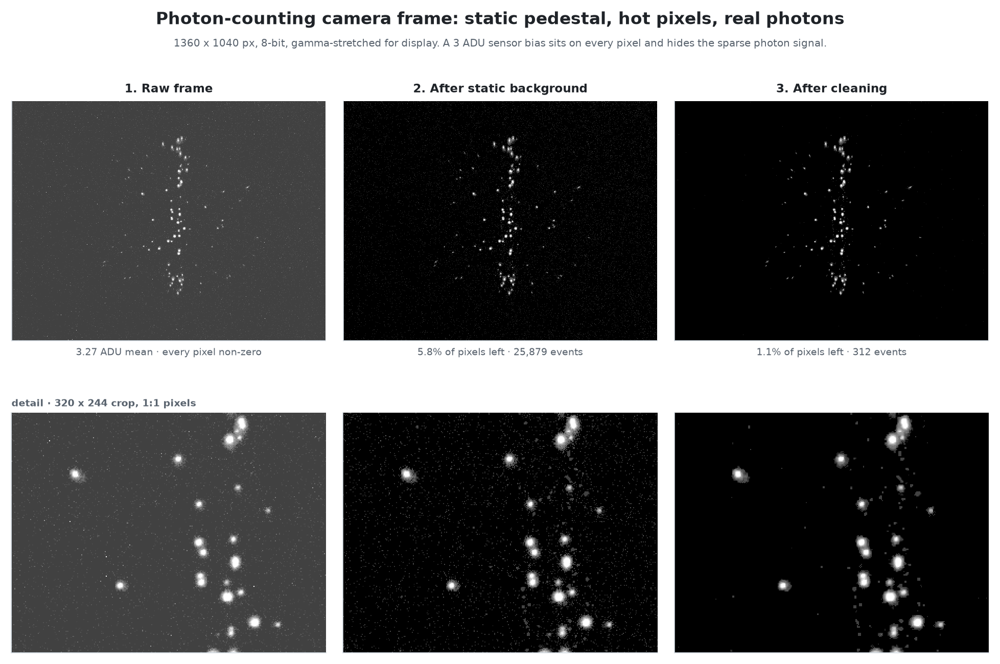
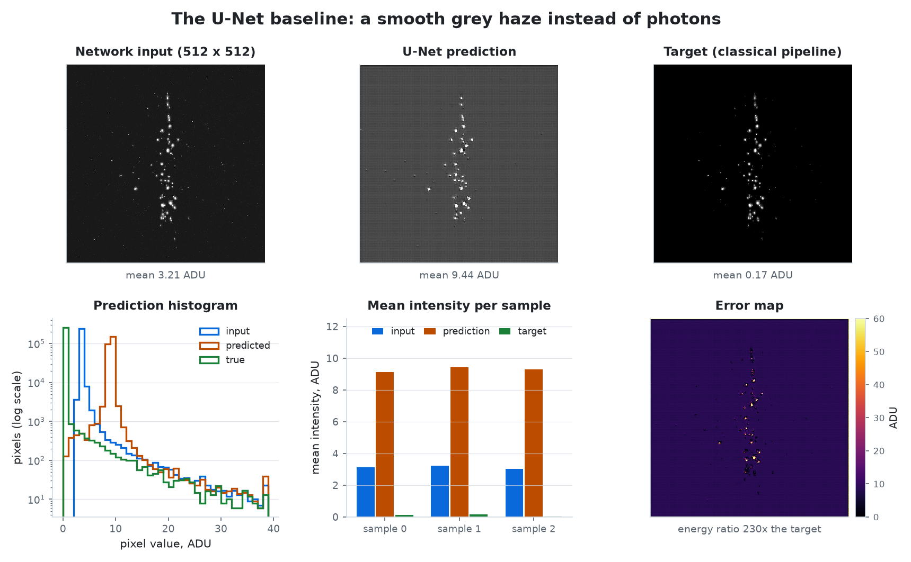
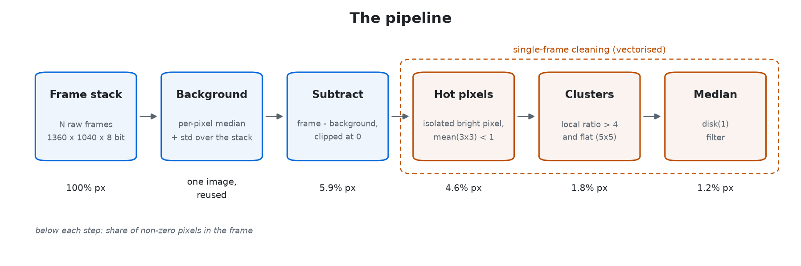
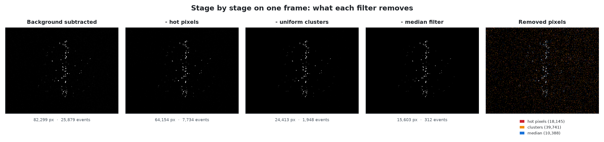
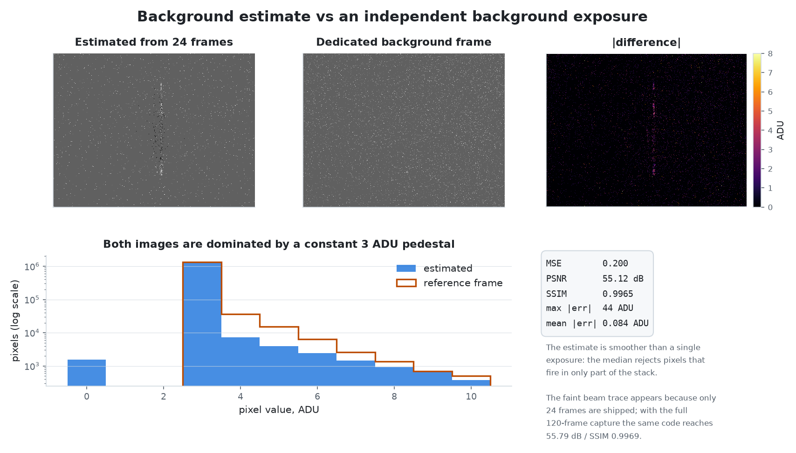
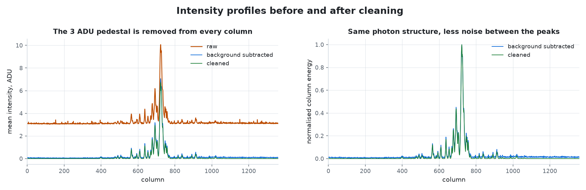
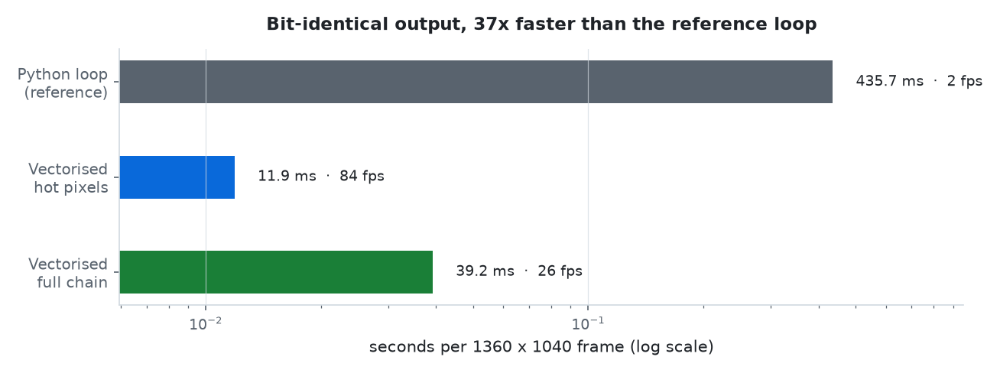

# Очистка фотонных кадров

[English](README.md) · **Русский**

[](https://github.com/d1m40fficial/photon-denoising/actions/workflows/tests.yml)
[](https://www.python.org/)
[](https://opencv.org/)
[](#%D1%81%D0%BA%D0%BE%D1%80%D0%BE%D1%81%D1%82%D1%8C)
[](LICENSE)

Восстановление разреженных фотонных событий на 8-битных кадрах камеры со счётом
фотонов: постоянный пьедестал на каждом пикселе, битые пиксели, которые выглядят
ровно как фотоны, и полезный сигнал примерно на 1 % площади кадра.

Классический полностью векторизованный конвейер справляется примерно за
**40 мс на кадр 1360 × 1040** на одном ядре CPU. Модель U-Net обучалась на тех же
данных, не заработала по измеримой причине и осталась в репозитории как
документированный отрицательный результат.



---

## Задача

В каждом кадре одновременно присутствуют три вещи, которые в 8-битной серой
шкале выглядят похоже:

| Что | Признак | Измерено |
| --- | --- | --- |
| Статический пьедестал | одинаковый сдвиг на всех пикселях во всех кадрах | 3 ADU на 98.6 % пикселей |
| Битые пиксели | яркие точки в фиксированных координатах, 1–6 пикселей | ~18 000 пикселей на кадр |
| Настоящие фотоны | пятна размером с функцию рассеяния, 2–4 пикселя, 10–255 ADU | ~310 событий на кадр |

Сырой кадр поэтому на 100 % состоит из ненулевых пикселей и выглядит серым:
фотоны в нём есть, но они утоплены в постоянном сдвиге глубиной всего 3 отсчёта.

## Результаты

| | |
| --- | --- |
| Оценка фона против независимой экспозиции | **55.12 dB PSNR**, SSIM 0.9965 |
| Доля ненулевых пикселей | 100 % → 5.88 % → **1.16 %** |
| Фотонных событий на кадр | 26 034 → **310** |
| Сохранённая энергия выше 50 ADU | **100.00 %** |
| Побитовое совпадение с исходной реализацией | **99.988 %** пикселей |
| Скорость | **≈25–30 кадров/с** (в 35–40 раз быстрее эталонного цикла) |

Все числа воспроизводятся на входящих в репозиторий данных командами
`scripts/evaluate.py` и `scripts/benchmark.py`; подробности —
в [`docs/results.md`](docs/results.md).

## Почему не нейросеть

Это самая долгая и самая поучительная часть проекта, поэтому она разобрана
отдельно: [`docs/why-not-yolo.md`](docs/why-not-yolo.md).

Коротко:

* **Детекция объектов — неверная абстракция.** У фотона нет границы,
  ограничивающий прямоугольник выбрасывает профиль интенсивности, а после
  детекции всё равно остаётся задача восстановления изображения.
* **U-Net просили выучить функцию, которой не существует.** Целевые изображения
  получены тем же классическим фильтром, который удаляет *любой* изолированный
  яркий пиксель. Для фрагмента с одним изолированным ярким пикселем правильный
  ответ — 0, был это дефект или фотон. Сеть могла выучить только условное
  среднее: серую пелену со средним 9.3 ADU при целевом 0.1 ADU.
* **Предобработка уже уничтожила сигнал.** При сборке датасета 512 × 512
  потерялось 70 % фотонных событий, доля одиночных событий упала с 58 % до 13 %,
  а соотношение сторон исказилось в 1.31 раза.



Пришедший ему на смену конвейер классический, без обучаемых параметров, и его
ошибки можно измерить.

## Как это работает



1. **Фон** — медиана и стандартное отклонение по стеку кадров для каждого
   пикселя. Пиксели со `std > 50` или `median < 1` не голосуют, поэтому битые и
   мерцающие пиксели не попадают в фон. Кадры обрабатываются батчами по 200, так
   что стек из тысячи кадров не нужно держать в памяти целиком.
2. **Вычитание** — `clip(frame - background, 0, 255)`.
3. **Битые пиксели** — удаляем пиксель, если он ярче 1 ADU, среднее по его
   ненулевым соседям в окне 3 × 3 меньше 1 ADU, а сам он ярче этого среднего
   более чем в 3 раза.
4. **Кластеры** — удаляем пиксели, которые в 4 раза ярче локального среднего
   *и* при этом плоские (отклонение от гауссова сглаживания меньше 15 %).
   Фотон — резкий пик, плато дефекта — нет.
5. **Медианный фильтр** — `disk(1)`, чтобы сгладить остатки.

Подробности — в [`docs/method.md`](docs/method.md).



## Проверка

**Фон.** Оценка сравнивается с отдельной фоновой экспозицией, которую алгоритм
никогда не видит. На 24 кадрах из репозитория совпадение 55.12 dB PSNR /
SSIM 0.9965, на полной серии из 120 кадров — 55.79 dB / 0.9969, что повторяет
число из исходного отчёта по практике.



**Точность воспроизведения.** Если подать сохранённые кадры `bg_subtracted`,
эта реализация воспроизводит `target` исходного ноутбука на 99.988 % пикселей
(78–83 dB PSNR). Оставшиеся ~200 пикселей на кадр — следствие ошибки
с изменением на месте в исходном цикле и другой версии `scikit-image`.

**Чем платим.** Суммарная энергия падает до 66.5 %, но вся потеря сосредоточена
в шуме 1–5 ADU: пиксели выше 50 ADU не трогаются вовсе, а выше 10 ADU
сохраняется 99.94 % энергии.



## Скорость

| Реализация | Время на кадр | Кадров / с |
| --- | --- | --- |
| Поэлементный цикл Python (эталон) | 0.40–0.45 с | 2–3 |
| Векторизованный фильтр битых пикселей | ~12 мс | ~85 |
| Векторизованный полный конвейер | 35–45 мс | 20–30 |

Векторизованный результат **побитово совпадает** с поэлементным эталоном:
ноль различающихся пикселей на 1 414 400.



## Быстрый старт

```bash
git clone https://github.com/d1m40fficial/photon-denoising.git && cd photon-denoising
pip install -e ".[figures]"
```

Оценить фон и очистить кадр:

```bash
photon-clean background --frames data/samples/frames --out background.png
photon-clean clean \
    --input data/samples/full/input/cam1_image_1.png \
    --background background.png \
    --out cleaned.png
```

Или из Python:

```python
from photon_clean import estimate_background_from_paths, subtract_background, clean_image
from photon_clean.io_utils import list_images, load_gray, save_gray

frames = list_images("data/samples/frames")
background, std_map = estimate_background_from_paths(frames)

frame = load_gray("data/samples/full/input/cam1_image_1.png")
cleaned = clean_image(subtract_background(frame, background))
save_gray(cleaned, "cleaned.png")
```

Собрать датасет из папок `input / bg_subtracted / target`:

```bash
python scripts/build_dataset.py --frames data/samples/frames --out data/derived/sample_dataset
```

Перегенерировать все рисунки и числа:

```bash
python scripts/evaluate.py            # results/metrics.json
python scripts/benchmark.py           # results/benchmark.json
python scripts/make_figures.py        # assets/*.png
python -m unittest discover -s tests  # 13 тестов
```

## Структура репозитория

```
photon-denoising/
├── src/photon_clean/       библиотека: фон, очистка, метрики, датасет, CLI
├── scripts/                evaluate, benchmark, build_dataset, make_figures
├── tests/                  13 unittest-тестов, без сети, меньше секунды
├── data/samples/           24 сырых кадра, 14 пар, 3 полных триплета
├── data/legacy/unet/       реальные предсказания U-Net
├── notebooks/legacy/       два исходных ноутбука (без выводов)
├── assets/                 все рисунки из этого README
├── docs/                   method, results, why-not-yolo
└── results/                metrics.json, benchmark.json
```

## Данные

Полный набор — 1133 кадра с семи камер (cam1–cam7) размером 1360 × 1040.
В репозитории лежит срез на 5 МБ, которого достаточно для воспроизведения всего
перечисленного: [`data/README.md`](data/README.md).

## Ограничения и планы

Честный список, потому что самое интересное в проекте — то, где он перестаёт
работать:

* **Одиночный фотон неотличим от битого пикселя.** И то и другое — один яркий
  пиксель без окружения, и фильтр удаляет оба. Поэтому энергия выше 50 ADU
  сохраняется полностью, а диапазон 1–5 ADU теряет 23 %; и поэтому сети, которая
  пыталась имитировать фильтр, было нечего выучить.
* **Идеально стабильный дефект медиана забирает в фон**, и он больше не чистится.
* **Метод однокадровый и не использует историю**, хотя именно история — то
  единственное свойство, которое разделяет два класса.

Планы:

- [ ] **Карта дефектов по времени.** Размечать пиксели по повторяемости в коротком
      стеке (дефект повторяется, фотон — нет), построить маску один раз на сессию
      и применять её к одиночным кадрам. Сейчас повторяются только 2.5 % удаляемых
      пикселей — то есть фильтр в основном удаляет шум, а карта по времени
      сохранила бы эти фотоны.
- [ ] **Не терять полное разрешение** ни в одном будущем ML-эксперименте и никогда
      не менять соотношение сторон при масштабировании.
- [ ] **Метрики с учётом пуассоновского шума.** MSE на изображении с 1 % ненулевых
      пикселей определяется фоном; значение имеют precision/recall на уровне событий.

## Документация

| Документ | Содержание |
| --- | --- |
| [`docs/method.md`](docs/method.md) | алгоритмы, параметры, сложность, режимы отказа |
| [`docs/results.md`](docs/results.md) | все измерения в таблицах |
| [`docs/why-not-yolo.md`](docs/why-not-yolo.md) | разбор YOLO и U-Net |
| [`data/README.md`](data/README.md) | что лежит в выборке и зачем |

## Лицензия

MIT — см. [`LICENSE`](LICENSE).
